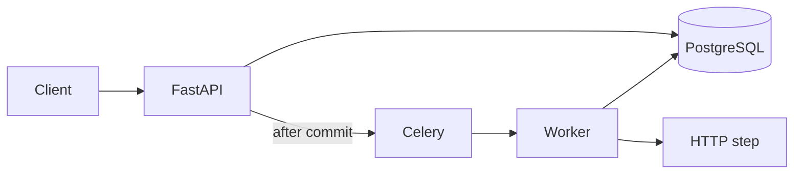

# FlowForge

A workflow run that leaves the request. Creating a run commits the run and its job together. A worker performs one HTTP step, with a retry budget and an idempotency key. Tenant routes require a membership row.

**Status:** portfolio project. One step type, one worker process, no production customers.

## Problem

Work done inside the handler dies with the connection. A header that names an organization, without checking membership, is not tenancy.

## Design



- **Membership.** `X-Tenant-ID` must match a membership for the caller. No row is 403. An unknown organization is 404.
- **One commit.** The run, the job, and the `run_queued` audit row commit together. The API enqueues only after that commit. If the broker is down, the job stays `queued`.
- **One step.** The worker POSTs the workflow URL with the run payload and `Idempotency-Key: <job id>`. Failure returns the job to `queued` until three attempts, then `failed`. A finished job is not sent again.

Register and login issue a JWT. Registration also creates a personal organization the user owns. `POST /api/v1/workflows` stores `target_url`. `POST /api/v1/workflows/{id}/runs` starts a run. `GET /api/v1/workflows/{id}/runs/{run_id}` returns status, attempts, and audit actions.

## Run

Python 3.12, PostgreSQL, and Redis.

```bash
python -m venv .venv
source .venv/bin/activate
pip install -e '.[dev]'
cp .env.example .env
docker compose up --build
```

For a database on localhost instead of the compose network, point `DATABASE_URL` at `127.0.0.1`. Apply the schema with `alembic upgrade head` if you are not starting from an empty volume that the tests migrate themselves.

API: `http://127.0.0.1:8000/docs`. The worker container runs `celery -A flowforge.workers.celery_app.celery_app worker`.

## Tests

`pytest` applies the Alembic migration to PostgreSQL and covers membership (403 and 404), the single commit that stores the run and the job, retry, the attempt budget, and a success that is not delivered twice. CI runs Ruff, that suite, and a Docker build. Postgres and Redis are provided in CI; the tests do not need Redis because enqueue is isolated from the broker.

## Limits

One HTTP step. One worker should run at a time: the row lock is held during the POST. Each database session opens its own connection. There is no lease, no scheduler, no second step type, and no Google OAuth, reports, or API keys. A crashed worker can leave a call in flight and send it again; the receiver dedupes on the job id. This is not a multi-region workflow engine.

## Decisions

- [ADR 001 Async boundary](docs/adr-001-async-boundary.md)
